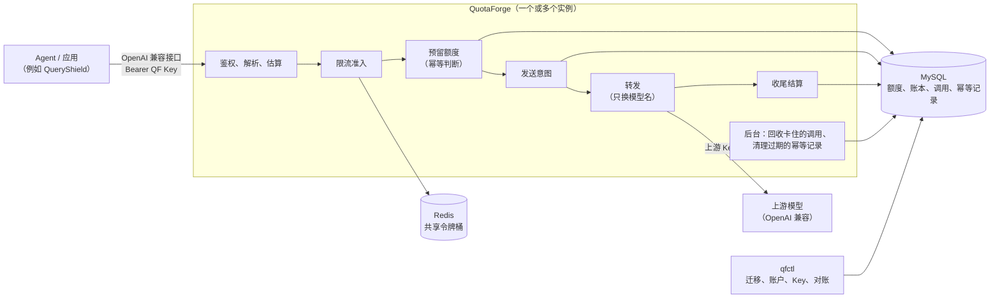

# QuotaForge

QuotaForge（QF）是给 Agent 用的大模型网关，用 Go 写成。Agent 和应用经它调用 OpenAI 兼容的上游模型。QF 负责每个账户能用多少、用得多快；重试不重复计费；调用结果不明时，事后能把账对清。

- **OpenAI 兼容转发**：`/v1/chat/completions`（含 tools）和 `/v1/embeddings`。只把模型别名换成上游的模型名，其余字节原样转发；上游的响应原样返回。
- **额度账本**：每个账户一个 token 上限。每次调用先在 MySQL 里按估算预留，结束后按上游报的用量结算。额度只以 MySQL 为准：并发预留不会超扣，`qfctl verify` 随时可以校验账本的不变量。
- **幂等**：请求带 `Idempotency-Key` 时，同一个键的重试不会多扣额度。结算过的调用原样重放；结果未知的调用不会重新执行。
- **未知用量的恢复和对账**：上游超时、进程被杀时，用量不补 0，记成“未知”，继续占着预留。后台回收接手卡住的调用；运维拿上游的账单或 QF 的日志结清。
- **共享限流**：Key、账户、上游三层，每层限每分钟的请求数和 token 数。令牌桶放在 Redis 里，由 Lua 脚本原子地扣，多个实例共享同一组桶。
- **多个实例**：实例之间不共享内存状态，同时跑也不会超扣、不会重复执行同一个键、不会重复回收。附带跨实例的检查脚本和压测数据。



## 已经完成

| 里程碑 | 内容 |
|---|---|
| M1 转发 | OpenAI 兼容的聊天和嵌入转发，QF 自己发的 Key，每次调用一行 JSON 日志；Docker 镜像和 Compose；和 QueryShield 端到端联调（[接口](docs/api.md#接口)、[接 QueryShield](docs/queryshield.md)） |
| M2 额度和幂等 | MySQL 额度账本（预留、结算、释放，`qfctl verify` 校验不变量）；`Idempotency-Key` 的重放、422、409（[额度和账本](docs/ledger.md#额度和账本)、[幂等](docs/api.md#幂等idempotency-key)） |
| M3 未知用量 | 发送意图、后台回收、调用状态查询 `GET /v1/calls/{id}`，凭账单或日志用 `qfctl reconcile` 对账（[调用状态、回收和对账](docs/ledger.md#调用状态回收和对账未知用量)） |
| M4 限流和多实例 | Redis 共享令牌桶（Key、账户、上游三层的 RPM、TPM）；两个实例的跨进程检查和压测（[限流](docs/rate-limiting.md)、[两个实例和压测](docs/scaling.md)） |

计划中：可观测（指标）、流式、多上游与熔断、Embedding 缓存、用量事件。

## 快速开始

要 Docker（带 Compose）和 curl。在项目根目录下运行。以下命令起 QF、账本数据库、Redis 和 QF 自己的假上游，不调用任何付费模型：

```bash
docker compose up -d --build --wait   # 等到健康为止
docker compose run --rm -T --no-deps qfctl account create -name local -limit 100000
KEY=$(docker compose run --rm -T --no-deps qfctl key issue -account local -models qs-fake-upstream-v1,fake-tool-call | sed -n 's/^key: //p')
curl -sS http://127.0.0.1:8080/healthz
curl -sS -i http://127.0.0.1:8080/v1/chat/completions -H "Authorization: Bearer $KEY" -H 'Content-Type: application/json' \
  -d '{"model":"qs-fake-upstream-v1","messages":[{"role":"user","content":"你好"}],"max_tokens":64}'
docker compose run --rm -T --no-deps qfctl usage -account local   # 已消费就是上面那次调用的 usage
docker compose down -v
```

- 端口只发布在 `127.0.0.1:8080`。账本数据库用 `deploy/test-only-db/` 下写明“仅测试”的密码；接真实上游时，脚本每次随机生成数据库密码（见[运行和运维](docs/operations.md)）。
- 更多请求的写法（带 tools 的聊天、嵌入、PowerShell）见[用 curl 调用](docs/api.md#用-curl-调用)。

## 和 QueryShield 的关系

[QueryShield](https://github.com/Jonsonwu0823-coding/queryshield)（QS）是一个查询 Agent，QF 是它的模型出口：QS 的聊天和嵌入都经 QF 调上游，一次 run 里的调用带上 run 编号（`X-Run-Id`）和幂等键。两边的联调脚本跑 QS 的整套演示，再拿 QF 的账本逐个 run 核对调用次数和用量，见[接 QueryShield](docs/queryshield.md)。

## 文档

| 文档 | 内容 |
|---|---|
| [接口和幂等](docs/api.md) | 接口、错误码、用 curl 调用、`Idempotency-Key` |
| [额度、账本和未知用量](docs/ledger.md) | 估算、预留、结算，锁的顺序，账本的不变量；调用状态、回收、对账、调用状态查询；数据库和迁移；用量导出 |
| [限流](docs/rate-limiting.md) | 三层令牌桶、Lua 脚本、TPM 的修正、Redis 不可用时的行为 |
| [运行和运维](docs/operations.md) | Docker Compose、冒烟脚本、配置文件、`qfctl`、不用 Docker 时怎么起、真实上游冒烟 |
| [两个实例和压测](docs/scaling.md) | 两个实例怎么共享状态、跨实例的检查、压测方法和结果 |
| [接 QueryShield](docs/queryshield.md) | 网络和配置、端到端联调、经 QS 的真实演示和对账 |
| [开发和测试](docs/development.md) | Go 版本和依赖、跑测试、测试库 |

## 许可证

[MIT](LICENSE)
