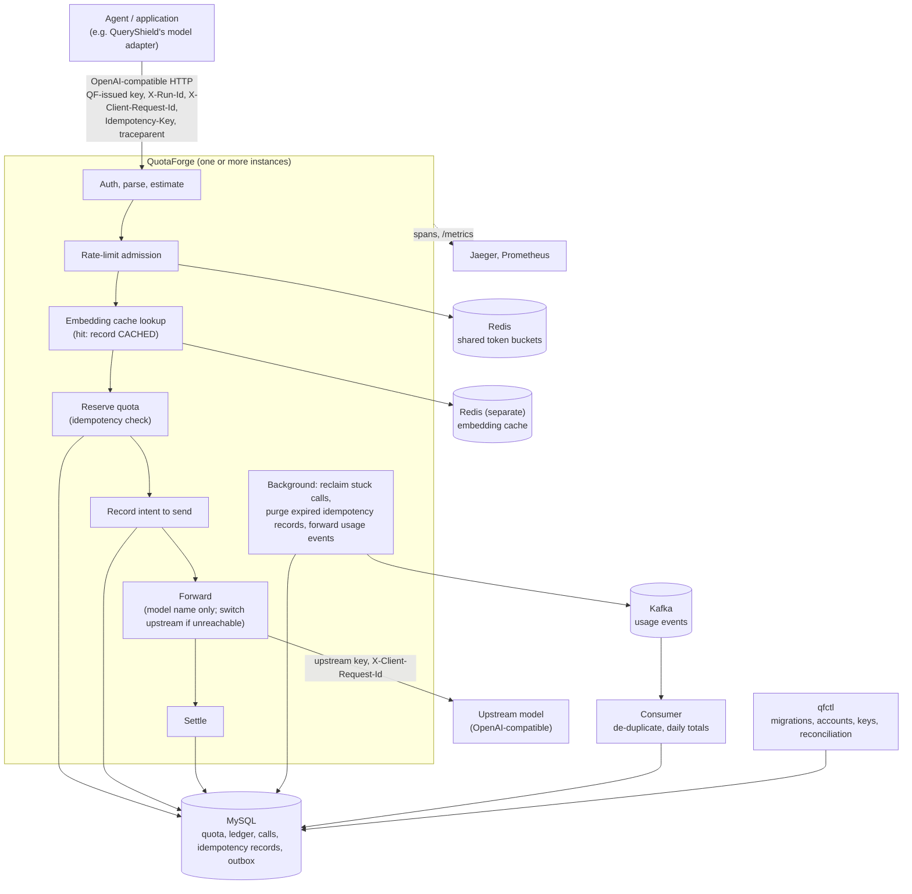

# QuotaForge

English | [中文](README.zh-CN.md)

QuotaForge (QF) is an LLM gateway for agents, written in Go. Agents and applications call OpenAI-compatible upstream models through it. QF controls how much each account may use and how fast; retries are never billed twice; and when the outcome of a call is unknown, the books can still be reconciled afterwards. It is an optional model gateway for [QueryShield](https://github.com/Jonsonwu0823-coding/queryshield) (a controlled agent for asking business-data questions in natural language), and it also works on its own.

## What it does

- **OpenAI-compatible forwarding**: `/v1/chat/completions` (including tools) and `/v1/embeddings`. For non-streaming requests only the model alias is replaced with the upstream model name and every other byte is forwarded as is; for streaming, QF also asks the upstream to include usage (exceptions in [streaming](docs/api.md#流式), Chinese). The upstream's 2xx response is returned as is.
- **Quota ledger**: each account has a token limit. Every call first reserves its estimate in MySQL and is settled with the usage the upstream reports. MySQL is the only authority on quota: concurrent reservations never overspend, and `qfctl verify` checks the ledger's invariants at any time.
- **Idempotency**: with an `Idempotency-Key`, retries of the same key are not charged again. A settled call is replayed byte for byte; a call whose outcome is unknown is never executed again.
- **Recovery and reconciliation of unknown usage**: the intent to send is recorded before the request goes out. When the upstream times out or the process is killed, usage is recorded as unknown instead of 0, and the reservation stays held. A background loop reclaims stuck calls; operators settle them with the upstream's bill or QF's own log.
- **Shared rate limiting**: three layers (key, account, upstream), each limiting requests and tokens per minute. Token buckets live in Redis and are charged atomically by a Lua script, so all instances share the same buckets.
- **Multiple instances**: instances share no in-memory state. Running several at once never overspends, never executes the same key twice and never reclaims a call twice. Cross-instance checks and benchmark data are included.
- **Streaming**: SSE events are forwarded one by one and billed from the usage in the stream; a client that disconnects mid-stream is still settled as usual.
- **Multiple upstreams and circuit breaking**: one alias can have several weighted targets (canary, primary/standby); QF switches upstream only when the connection could not be made, and breaks the circuit per upstream.
- **Embedding cache** (optional): identical embedding requests from the same account reuse a previously settled response, without calling the upstream or using quota; the ledger records a `CACHED` call. Concurrent identical requests in one instance go upstream once; a broken cache only counts as a miss.
- **Usage events** (optional): when a call is resolved, an outbox row is written in the same database transaction; a background loop forwards it to Kafka (at least once), a consumer de-duplicates by call ID and aggregates per account per day, and `qfctl usage-reconcile` reconciles the totals with the ledger.
- **Observability**: OpenTelemetry tracing (one span tree per call, accepting W3C `traceparent`), Prometheus metrics, SLOs and alert rules, and logs correlated by call ID and `trace_id`.

## Architecture overview



MySQL is the only authority on quota; Redis is used only for rate limiting and caching, so losing it can at most let a few extra requests through or cause a few extra upstream calls. Components, the sequence of one request, call states and deployment are in the [architecture document](docs/architecture.md) (Chinese).

## Quick start

You need Docker (with Compose) and curl. Run from the project root. These commands start QF, the ledger database, Redis and QF's own fake upstream; no paid model is called:

```bash
docker compose up -d --build --wait   # wait until healthy
docker compose run --rm -T --no-deps qfctl account create -name local -limit 100000
KEY=$(docker compose run --rm -T --no-deps qfctl key issue -account local -models qs-fake-upstream-v1,fake-tool-call | sed -n 's/^key: //p')
curl -sS http://127.0.0.1:8080/healthz
curl -sS -i http://127.0.0.1:8080/v1/chat/completions -H "Authorization: Bearer $KEY" -H 'Content-Type: application/json' \
  -d '{"model":"qs-fake-upstream-v1","messages":[{"role":"user","content":"hello"}],"max_tokens":64}'
docker compose run --rm -T --no-deps qfctl usage -account local   # consumed equals the usage of the call above
docker compose down -v
```

- The port is published on `127.0.0.1:8080` only. The ledger database uses the passwords marked "test only" under `deploy/test-only-db/`; with a real upstream, the script generates fresh random database passwords each time (see [operations](docs/operations.md), Chinese).
- More request examples (chat with tools, embeddings, streaming, PowerShell) are in [calling with curl](docs/api.md#用-curl-调用) (Chinese). The demo script for each feature is listed in the [evidence list](docs/evidence.md#记录的结果) (Chinese).

## Milestones

All seven milestones are complete.

| Milestone | Contents |
|---|---|
| M1 Forwarding | OpenAI-compatible chat and embedding forwarding, QF-issued keys, one JSON log line per call; Docker image and Compose; end-to-end integration with QueryShield ([API](docs/api.md#接口), [QueryShield](docs/queryshield.md)) |
| M2 Quota and idempotency | MySQL quota ledger (reserve, settle, release; `qfctl verify` checks invariants); `Idempotency-Key` replay, 422, 409 ([quota and ledger](docs/ledger.md#额度和账本), [idempotency](docs/api.md#幂等idempotency-key)) |
| M3 Unknown usage | Intent to send, background reclaim, call status lookup `GET /v1/calls/{id}`, reconciliation with a bill or log via `qfctl reconcile` ([call states, reclaim and reconciliation](docs/ledger.md#调用状态回收和对账未知用量)) |
| M4 Rate limiting and multiple instances | Shared Redis token buckets (RPM and TPM for key, account and upstream); cross-process checks with two instances and benchmarks ([rate limiting](docs/rate-limiting.md), [two instances and benchmarks](docs/scaling.md)) |
| M5 Observability | OpenTelemetry tracing, Prometheus metrics, SLOs and alert rules, logs correlated by call ID and `trace_id`; a Jaeger and Prometheus demo environment ([observability](docs/observability.md)) |
| M6 Streaming, multiple upstreams, cache, usage events | SSE streaming and billing ([streaming](docs/api.md#流式)); multiple upstreams, weighted routing, failover and circuit breaking ([multiple upstreams](docs/operations.md#多个上游)); embedding cache ([embedding cache](docs/api.md#嵌入缓存)); usage events, Kafka and daily totals ([usage events](docs/ledger.md#用量事件)) |
| M7 Integration, review, docs | End-to-end integration with QueryShield (five scenarios, cross-service traces); full code review and simplification; architecture, evidence list and retrospective ([architecture](docs/architecture.md), [evidence](docs/evidence.md), [retrospective](docs/retrospective.md)) |

All linked documents are in Chinese.

## Relationship with QueryShield

[QueryShield](https://github.com/Jonsonwu0823-coding/queryshield) (QS) is a controlled agent for asking business-data questions in natural language, and QF is its optional model gateway (QS can also call the upstream directly). When QS uses QF, all of its chat and embedding calls go through QF: every request carries `traceparent`, and the calls in one run also carry the run ID (`X-Run-Id`) and an idempotency key. The integration script runs QS's full demo, then checks the number of calls and the usage of every run against QF's ledger, and checks the cross-service traces in one Jaeger; see [QueryShield integration](docs/queryshield.md) (Chinese).

## Verification and evidence

- **Tests**: 725 tests (including subtests) in the full `go test -race` run with MySQL, Redis and Kafka; all passed in the public CI on `a56cd4b` on 2026-10-19.
- **Demo scripts**: nine, each starting from an empty environment, all run in CI. The QS integration has five scenarios with 40, 4, 25, 27 and 43 checks, 139 in total; the smoke test has 147.
- **Real upstream**: on a local Windows machine, QS's real demo called Alibaba Cloud Model Studio through QF and was reconciled run by run: on 2026-10-15 (`a7847c0`) all 13 runs matched with 0 failures; on 2026-10-19 (`a56cd4b`, embedding cache on) two demos in the same QF both passed, and the 4 embeddings that rebuilt the knowledge index in the second demo all hit the cache.
- **Benchmarks**: two machines and two instances; results and bottleneck analysis in [two instances and benchmarks](docs/scaling.md#压测) (Chinese).

The [evidence list](docs/evidence.md) maps every capability to its code, tests, commands and recorded results; problems found during development and how they were fixed are in the [retrospective](docs/retrospective.md) (both in Chinese).

## Known limitations

- **Quota**: one token limit per account, with no periodic reset, no money-based billing and no per-model weighting ([quota and ledger](docs/ledger.md#额度和账本)).
- **Unknown usage without evidence keeps its reservation**: Model Studio provides no per-call bill, so a call that timed out on the real upstream has no evidence and stays `USAGE_UNKNOWN` ([call states, reclaim and reconciliation](docs/ledger.md#调用状态回收和对账未知用量)).
- **Conservative estimates**: input is estimated from the request body's bytes and output from `max_tokens`, so reservations are often much larger than actual usage ([rate limiting](docs/rate-limiting.md#限流redis)).
- **Hot accounts**: all requests of one account queue on the same quota row, about 150 requests per second on the test machine ([benchmarks](docs/scaling.md#压测)).
- **Single-node Redis only**, no Redis Cluster; upstream rate limits are per upstream, not per model ([rate limiting](docs/rate-limiting.md#限流redis)).
- **Embedding cache** is exact-match, and request coalescing is per instance; if the upstream silently swaps the model behind a name, old vectors are served for at most one TTL ([embedding cache](docs/api.md#嵌入缓存)).
- **Streaming calls cannot be replayed**: a key is still executed at most once, but a retry gets 409 ([idempotency](docs/api.md#幂等idempotency-key)).
- **Circuit breaking** counts consecutive failures, and each instance keeps its own state ([multiple upstreams](docs/operations.md#多个上游)).
- **No HTTP admin API**: accounts, keys and reconciliation use `qfctl`, which connects to the database directly ([qfctl](docs/operations.md#qfctl)).
- **Model Studio is the only real upstream tested**; streaming on a real upstream and failover between two real upstreams are not yet verified ([not yet verified](docs/evidence.md#还没做的验证)).

All linked documents are in Chinese.

## Repository layout

```text
cmd/
  quotaforge/     the server (plus subcommands healthcheck, usage-consumer, usage-export)
  qfctl/          admin tool: migrations, accounts, keys, usage, verification, reconciliation
  fakeupstream/   QF's own fake upstream (for tests and demos)
  qfbench/        load and burst tool
internal/
  gateway/        HTTP gateway: auth, admission, reservation, forwarding, settlement, streaming, cache, logs
  ledger/         MySQL quota ledger, idempotency, reclaim, reconciliation, outbox, migrations
  ratelimit/      Redis token buckets (Lua script)
  embcache/       Redis client for the embedding cache
  redisconn/      settings shared by the two Redis clients
  usageevents/    forwarding and consuming usage events (Kafka)
  telemetry/      tracing (OTLP/JSON exporter) and Prometheus metrics
  config/         loading and validating the config file
  apikey/         key generation and hashing
  fakeupstream/   the fake upstream's implementation
  dbtest/         database, Redis and Kafka helpers shared by tests
deploy/           configs for Compose, MySQL init script, Prometheus rules, test-only database passwords
scripts/          demo and check scripts (bash; run on Linux and macOS; the real-upstream compose-real.sh only on Linux so far; Git Bash on Windows not yet), the integration checker (Python)
bench/            benchmark results and raw data
docs/             documentation (Chinese)
compose*.yaml     the main Compose file and overlays
vendor/           dependencies (no network access needed to build)
```

## Documentation

All documents are in Chinese.

| Document | Contents |
|---|---|
| [Architecture](docs/architecture.md) | Overview, components, sequence of one request, embedding cache coalescing, call states, deployment, design trade-offs |
| [Evidence list](docs/evidence.md) | Code, tests, commands and recorded results for each capability; what is not yet verified |
| [Retrospective](docs/retrospective.md) | Twelve problems found during development: symptom, root cause, fix, verification, lesson |
| [API and idempotency](docs/api.md) | Endpoints, error codes, streaming, embedding cache, calling with curl, `Idempotency-Key` |
| [Quota, ledger and unknown usage](docs/ledger.md) | Estimates, reservation, settlement, lock order, ledger invariants; call states, reclaim, reconciliation, call status lookup; database and migrations; usage events; usage export |
| [Rate limiting](docs/rate-limiting.md) | Three layers of token buckets, the Lua script, TPM correction, behavior when Redis is unavailable |
| [Operations](docs/operations.md) | Docker Compose, smoke scripts, environment variables, config file, multiple upstreams and circuit breaking, embedding cache, usage events, `qfctl`, running without Docker, real-upstream smoke test |
| [Two instances and benchmarks](docs/scaling.md) | How two instances share state, cross-instance checks, benchmark method and results |
| [Observability](docs/observability.md) | Span tree, log correlation, metrics, SLOs and alerts, the Jaeger and Prometheus demo environment |
| [QueryShield integration](docs/queryshield.md) | Network and config, end-to-end integration, real demo through QS and reconciliation |
| [Development and testing](docs/development.md) | Go version and dependencies, running tests, test database, Redis and Kafka for tests |

## License

[MIT](LICENSE)
