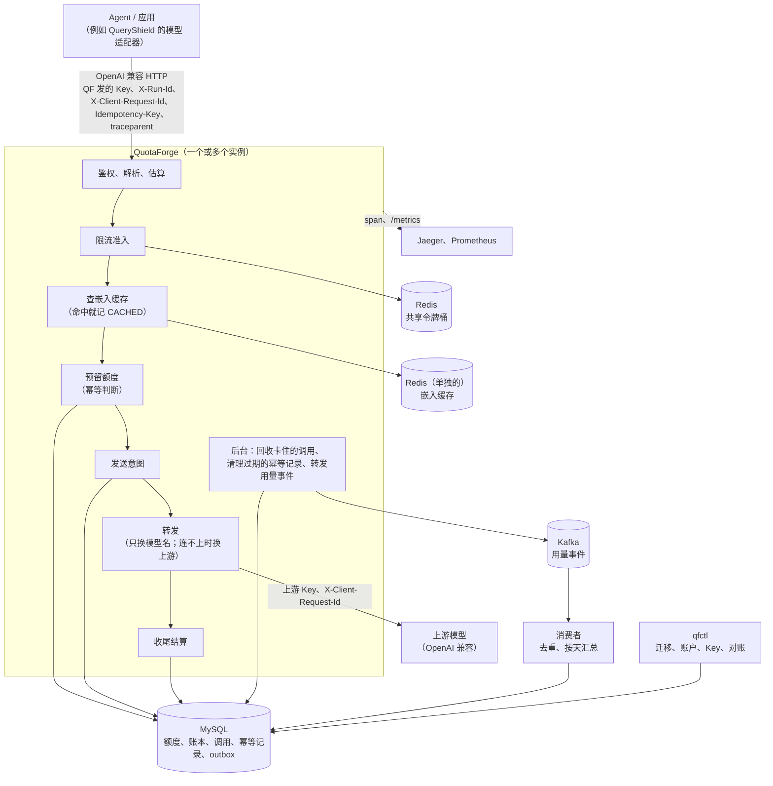

# QuotaForge

[English](README.md) | 中文

QuotaForge（QF）是给 Agent 用的大模型网关，用 Go 写成。Agent 和应用经它调用 OpenAI 兼容的上游模型。QF 负责每个账户能用多少、用得多快；重试不重复计费；调用结果不明时，事后能把账对清。它是 [QueryShield](https://github.com/Jonsonwu0823-coding/queryshield)（一个用自然语言查询经营数据的受控 Agent）可选的模型出口，也可以单独使用。

## 做什么

- **OpenAI 兼容转发**：`/v1/chat/completions`（含 tools）和 `/v1/embeddings`。非流式只把模型别名换成上游的模型名，其余字节原样转发；流式另外让上游带上 usage，例外见[流式](docs/api.md#流式)；上游的 2xx 响应原样返回。
- **额度账本**：每个账户一个 token 上限。每次调用先在 MySQL 里按估算预留，结束后按上游报的用量结算。额度只以 MySQL 为准：并发预留不会超扣，`qfctl verify` 随时可以校验账本的不变量。
- **幂等**：请求带 `Idempotency-Key` 时，同一个键的重试不会多扣额度。结算过的调用原样重放；结果未知的调用不会重新执行。
- **未知用量的恢复和对账**：发请求之前先记下发送意图。上游超时、进程被杀时，用量不补 0，记成“未知”，继续占着预留。后台回收接手卡住的调用；运维拿上游的账单或 QF 的日志结清。
- **共享限流**：Key、账户、上游三层，每层限每分钟的请求数和 token 数。令牌桶放在 Redis 里，由 Lua 脚本原子地扣，多个实例共享同一组桶。
- **多个实例**：实例之间不共享内存状态，同时跑也不会超扣、不会重复执行同一个键、不会重复回收。附带跨实例的检查脚本和压测数据。
- **流式**：SSE 逐个转发，按流里的 usage 结算，客户端中途断开照常结算。
- **多个上游和熔断**：一个别名多个目标，按权重分流（灰度、主备）；只在连不上时换上游，按上游熔断。
- **嵌入缓存**（可选）：同一个账户的相同嵌入请求直接用之前结算过的响应，不调上游、不扣额度，账本里记一条 `CACHED`。同一个实例里并发的相同请求只回源一次；缓存坏了只算没命中。
- **用量事件**（可选）：调用结清时，在同一个数据库事务里写一行 outbox；后台转发到 Kafka（至少一次），消费者按调用号去重、按账户按天汇总，`qfctl usage-reconcile` 拿汇总和账本对账。
- **可观测**：OpenTelemetry 追踪（一次调用一棵 span 树，接收 W3C `traceparent`）、Prometheus 指标、SLO 和告警规则，日志按调用号和 `trace_id` 关联。

## 架构概览



额度只以 MySQL 为准；Redis 只做限流和缓存，丢了只会多放一些请求或多回源几次。组件、一次请求的时序、调用的状态和部署见[架构说明](docs/architecture.md)。

## 快速开始

要 Docker（带 Compose）和 curl。在项目根目录下运行。以下命令起 QF、账本数据库、Redis 和 QF 自己的假上游，不调用任何付费模型：

```bash
docker compose up -d --build --wait   # 等到健康为止
docker compose run --rm -T --no-deps qfctl account create -name local -limit 100000
KEY=$(docker compose run --rm -T --no-deps qfctl key issue -account local -models qs-fake-upstream-v1,fake-tool-call | sed -n 's/^key: //p')
curl -sS http://127.0.0.1:8080/healthz
curl -sS -i http://127.0.0.1:8080/v1/chat/completions -H "Authorization: Bearer $KEY" -H 'Content-Type: application/json' \
  -d '{"model":"qs-fake-upstream-v1","messages":[{"role":"user","content":"你好"}],"max_tokens":64}'
docker compose run --rm -T --no-deps qfctl usage -account local   # 已消费就是上面那次调用的 usage
docker compose down -v
```

- 端口只发布在 `127.0.0.1:8080`。账本数据库用 `deploy/test-only-db/` 下写明“仅测试”的密码；接真实上游时，脚本每次随机生成数据库密码（见[运行和运维](docs/operations.md)）。
- 更多请求的写法（带 tools 的聊天、嵌入、流式、PowerShell）见[用 curl 调用](docs/api.md#用-curl-调用)。每项功能的演示脚本见[能力证据清单](docs/evidence.md#记录的结果)。

## 里程碑

七个里程碑都已完成。

| 里程碑 | 内容 |
|---|---|
| M1 转发 | OpenAI 兼容的聊天和嵌入转发，QF 自己发的 Key，每次调用一行 JSON 日志；Docker 镜像和 Compose；和 QueryShield 端到端联调（[接口](docs/api.md#接口)、[接 QueryShield](docs/queryshield.md)） |
| M2 额度和幂等 | MySQL 额度账本（预留、结算、释放，`qfctl verify` 校验不变量）；`Idempotency-Key` 的重放、422、409（[额度和账本](docs/ledger.md#额度和账本)、[幂等](docs/api.md#幂等idempotency-key)） |
| M3 未知用量 | 发送意图、后台回收、调用状态查询 `GET /v1/calls/{id}`，凭账单或日志用 `qfctl reconcile` 对账（[调用状态、回收和对账](docs/ledger.md#调用状态回收和对账未知用量)） |
| M4 限流和多实例 | Redis 共享令牌桶（Key、账户、上游三层的 RPM、TPM）；两个实例的跨进程检查和压测（[限流](docs/rate-limiting.md)、[两个实例和压测](docs/scaling.md)） |
| M5 可观测 | OpenTelemetry 追踪、Prometheus 指标、SLO 和告警规则、日志按调用号和 `trace_id` 关联；Jaeger 加 Prometheus 的演示环境（[可观测](docs/observability.md)） |
| M6 流式、多上游、缓存、用量事件 | SSE 流式转发和计费（[流式](docs/api.md#流式)）；多个上游、按权重分流、换上游和熔断（[多个上游](docs/operations.md#多个上游)）；嵌入缓存（[嵌入缓存](docs/api.md#嵌入缓存)）；用量事件、Kafka 和按天汇总（[用量事件](docs/ledger.md#用量事件)） |
| M7 联调、审核、文档 | 和 QueryShield 的端到端联调（五个场景，跨服务 trace）；全量代码审核与精简；架构说明、能力证据清单、问题复盘（[架构说明](docs/architecture.md)、[能力证据清单](docs/evidence.md)、[问题复盘](docs/retrospective.md)） |

## 和 QueryShield 的关系

[QueryShield](https://github.com/Jonsonwu0823-coding/queryshield)（QS）是一个用自然语言查询经营数据的受控 Agent，QF 是它可选的模型出口（QS 也能直连上游）。QS 接 QF 时，聊天和嵌入都经 QF 调上游：每个请求都带 `traceparent`，一次 run 里的调用还带 run 编号（`X-Run-Id`）和幂等键。两边的联调脚本跑 QS 的整套演示，再拿 QF 的账本逐个 run 核对调用次数和用量，并在同一个 Jaeger 里核对跨服务的 trace，见[接 QueryShield](docs/queryshield.md)。

## 验证和证据

- **测试**：带 MySQL、Redis、Kafka 的全量 `go test -race` 一共 725 个（含子测试），2026-10-19 的公开 CI 在 `a56cd4b` 上全部通过。
- **演示脚本**：九个，每个从空环境起，CI 都跑。和 QS 的联调五个场景 40、4、25、27、43 项，一共 139 项；冒烟 147 项。
- **真实上游**：本机（Windows）用 QS 的真实演示经 QF 调阿里云百炼，按 run 逐个对账：2026-10-15（`a7847c0`）13 个 run 都对上、0 failed；2026-10-19（`a56cd4b`，开着嵌入缓存）同一个 QF 里两遍演示都通过，第二遍建知识索引的 4 次嵌入全部命中。
- **压测**：两台机器、两个实例，结果和瓶颈分析见[两个实例和压测](docs/scaling.md#压测)。

每项能力对到代码、测试、命令和记录的结果，见[能力证据清单](docs/evidence.md)；开发中遇到的问题和修法见[问题复盘](docs/retrospective.md)。

## 已知限制

- **额度**：每个账户一个 token 上限，不按周期重置，不按钱计费、不按模型加权（[额度和账本](docs/ledger.md#额度和账本)）。
- **没有证据的未知用量一直占着预留**：百炼不提供按调用的账单，真实上游超时的调用拿不到证据，会一直是 `USAGE_UNKNOWN`（[调用状态、回收和对账](docs/ledger.md#调用状态回收和对账未知用量)）。
- **估算偏保守**：输入按请求体字节数、输出按 `max_tokens` 估，预留量常常远大于实际用量（[限流](docs/rate-limiting.md#限流redis)）。
- **热点账户**：一个账户的所有请求在同一个额度行上排队，测试机器上约 150 次/秒（[压测](docs/scaling.md#压测)）。
- **只支持单机 Redis**，不支持 Redis Cluster；上游的限流按上游，不按模型（[限流](docs/rate-limiting.md#限流redis)）。
- **嵌入缓存**是精确匹配，合并回源只在一个实例里；上游悄悄换了同名模型时，旧向量最多再用一个过期时长（[嵌入缓存](docs/api.md#嵌入缓存)）。
- **流式的调用不能重放**：同一个键最多执行一次，但重试得到 409（[幂等](docs/api.md#幂等idempotency-key)）。
- **熔断**按连续失败计数，每个实例各记各的（[多个上游](docs/operations.md#多个上游)）。
- **没有 HTTP 管理接口**：账户、Key、对账都用直连数据库的 `qfctl`（[qfctl](docs/operations.md#qfctl)）。
- **只在百炼上跑过真实上游**；真实上游的流式、两个真实上游之间的换上游还没验证（[还没做的验证](docs/evidence.md#还没做的验证)）。

## 目录结构

```text
cmd/
  quotaforge/     服务（还有子命令 healthcheck、usage-consumer、usage-export）
  qfctl/          管理工具：迁移、账户、Key、用量、校验、对账
  fakeupstream/   QF 自己的假上游（测试和演示用）
  qfbench/        压测和齐发工具
internal/
  gateway/        HTTP 网关：鉴权、准入、预留、转发、收尾、流式、缓存、日志
  ledger/         MySQL 额度账本、幂等、回收、对账、outbox、迁移
  ratelimit/      Redis 令牌桶（Lua 脚本）
  embcache/       嵌入缓存的 Redis 客户端
  redisconn/      两个 Redis 客户端共同的设置
  usageevents/    用量事件的转发和消费（Kafka）
  telemetry/      追踪（OTLP/JSON 导出器）和 Prometheus 指标
  config/         配置文件的加载和校验
  apikey/         Key 的生成和哈希
  fakeupstream/   假上游的实现
  dbtest/         测试共用的数据库、Redis、Kafka 辅助函数
deploy/           Compose 用的配置、MySQL 初始化脚本、Prometheus 规则、仅测试的数据库密码
scripts/          演示和检查脚本（bash），真实上游的 PowerShell 脚本，联调的核对脚本（Python）
bench/            压测的结果和原始数据
docs/             文档（中文）
compose*.yaml     Compose 的主文件和覆盖文件
vendor/           依赖（构建时不联网下载）
```

## 文档

| 文档 | 内容 |
|---|---|
| [架构说明](docs/architecture.md) | 总览、组件、一次请求的时序、嵌入缓存的合并回源、调用状态、部署、设计取舍 |
| [能力证据清单](docs/evidence.md) | 每项能力的代码、测试、命令和记录的结果；还没做的验证 |
| [问题复盘](docs/retrospective.md) | 开发中遇到的十二个问题：现象、根因、修复、怎么验证、教训 |
| [接口和幂等](docs/api.md) | 接口、错误码、流式、嵌入缓存、用 curl 调用、`Idempotency-Key` |
| [额度、账本和未知用量](docs/ledger.md) | 估算、预留、结算，锁的顺序，账本的不变量；调用状态、回收、对账、调用状态查询；数据库和迁移；用量事件；用量导出 |
| [限流](docs/rate-limiting.md) | 三层令牌桶、Lua 脚本、TPM 的修正、Redis 不可用时的行为 |
| [运行和运维](docs/operations.md) | Docker Compose、冒烟脚本、环境变量、配置文件、多个上游和熔断、嵌入缓存、用量事件、`qfctl`、不用 Docker 时怎么起、真实上游冒烟 |
| [两个实例和压测](docs/scaling.md) | 两个实例怎么共享状态、跨实例的检查、压测方法和结果 |
| [可观测](docs/observability.md) | span 树、日志关联、指标清单、SLO 和告警、Jaeger 加 Prometheus 的演示环境 |
| [接 QueryShield](docs/queryshield.md) | 网络和配置、端到端联调、经 QS 的真实演示和对账 |
| [开发和测试](docs/development.md) | Go 版本和依赖、跑测试、测试库和测试用的 Redis、Kafka |

## 许可证

[MIT](LICENSE)
