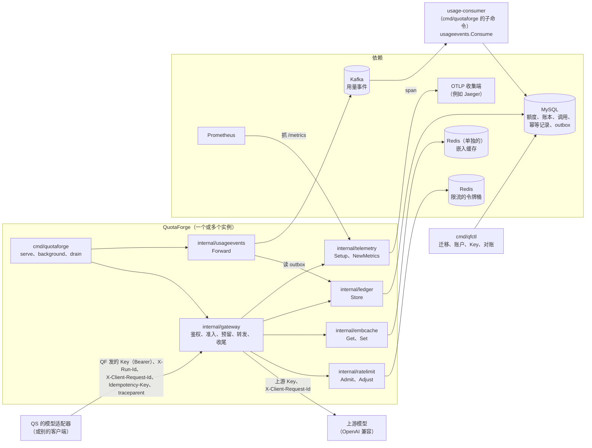
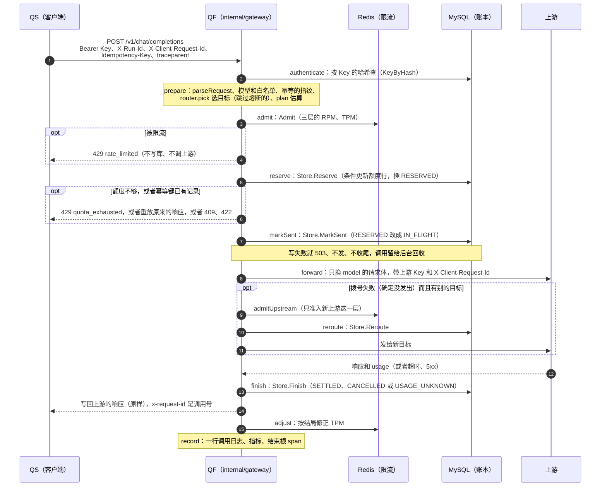
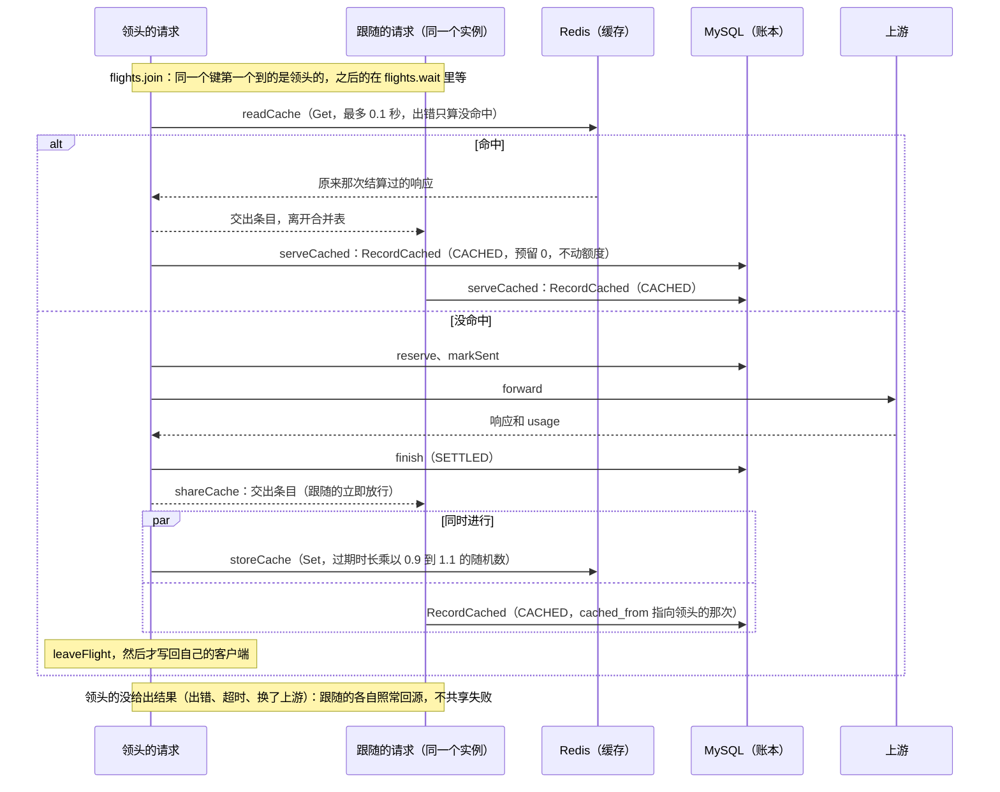
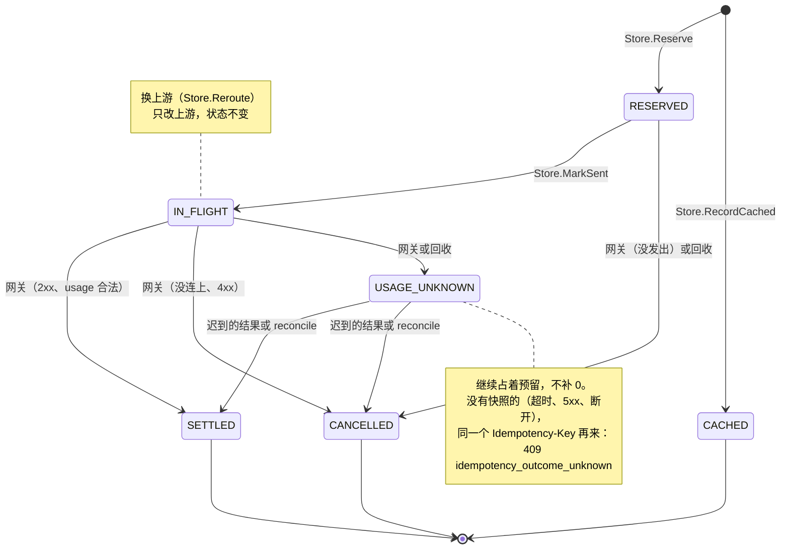
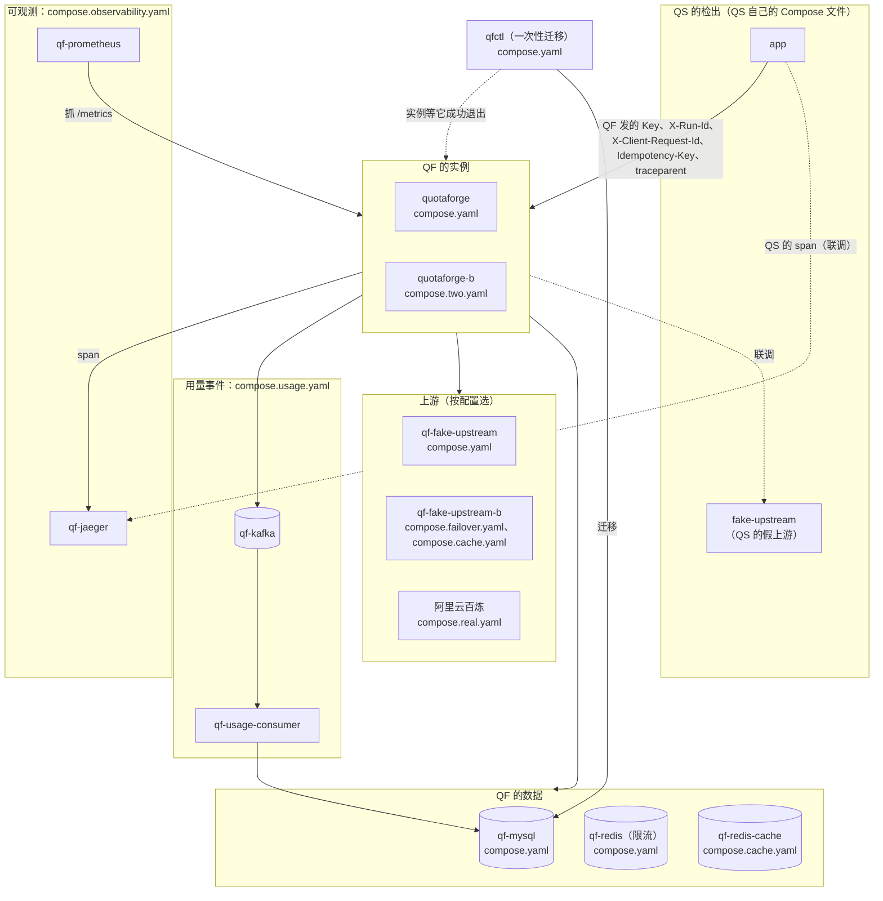

# 架构说明

QuotaForge（QF）是一个大模型网关：客户端用 OpenAI 兼容的接口调它，它替客户端调上游模型。QF 自己管三件事：每个账户能用多少（额度），用得多快（限流），调用结果不明时怎么把账对清（未知用量的恢复）。本文先给总览，再按组件说明代码在哪里，然后是一次请求的完整流程、调用的状态和部署。代码位置都相对于仓库根目录，写的是符号名，行号会随代码变化。每一节都链到讲取舍的文档。

## 总览

- **边界**：QS（QueryShield）是一个用自然语言查询经营数据的受控 Agent，QF 是它可选的模型出口（QS 也能直连上游）。两边的图在边界上画法相同：QS 的模型适配器 → QuotaForge → 上游。QS 的每个请求都带 QF 发的 Key、`X-Client-Request-Id`（QS 自己的请求号）和 `traceparent`（W3C 追踪上下文，让一个 run 在两边连成同一条 trace）。一次 run 里的调用（聊天和查询嵌入）还带 `X-Run-Id`（这次 run 的编号，按 run 对账用）和 `Idempotency-Key`（同一个键的重试不重复计费）。不属于 run 的调用（建知识索引的嵌入、脚本里的连通探针）不带后两个，每次各是一条新的 trace。接法见[接 QueryShield](queryshield.md#接-qs)。
- **发给上游的**：QF 设的头只有上游的 Key、`Content-Type`、`Accept` 和 `X-Client-Request-Id`（Go 的 HTTP 客户端另外会加 `User-Agent`、`Accept-Encoding` 这类头）。最后这个的值是 QF 的调用号，按调用对账单时用。客户端的头不转发，`traceparent` 也不发（见[接口](api.md#接口)）。
- **额度只以 MySQL 为准**：Redis 只放限流的状态和嵌入缓存，丢了只会多放一些请求或多回源几次，不会算错账。两者之间没有跨库事务，取舍见[限流](rate-limiting.md#限流redis)。

## 组件

### 入口和配置

`cmd/quotaforge/main.go` 的 `serve` 读配置、打开账本、建限流和嵌入缓存的 Redis 客户端（启动时不连 Redis）、开指标和追踪、起后台循环和用量事件的转发，再用 `gateway.New` 建处理器、开始服务。`newHandler` 只挂两条路由：`GET /healthz` 和 `/v1/` 下的网关。收到 SIGINT、SIGTERM 时，`run` 调 `http.Server.Shutdown` 等进行中的请求做完，上限是 `config.Config.ShutdownTimeout`（等于回收的上界，默认 36 秒）；后台循环和用量事件的转发跟着同一个信号的 context 一起停，和 HTTP 的排空同时进行；`drain` 按顺序等后台循环、转发停下，再冲刷还没导出的 span（这个顺序由 `TestDrainOrder` 守着）。同一个程序还有三个子命令：`healthcheck`、`usage-consumer`、`usage-export`。

`internal/config` 的 `Load` 一次性校验配置文件，不认识的字段也算错；之后只读。固定的超时也在这里：每次账本操作 2 秒（`LedgerTimeout`）、每次限流操作 0.5 秒（`RateLimitTimeout`）、每次缓存读写 0.1 秒（`CacheTimeout`）；回收的上界 `ReclaimAfter` 由上游超时算出来。见[配置文件](operations.md#配置文件)。

### 网关（`internal/gateway`）

`gateway.go` 的 `endpoint` 是每个请求的入口，按顺序调 `authenticate`、`serve`（里面是 `prepare`、`admit`、`lookupCache`、`reserve`、`deliver`）。它在 defer 里注册收尾之后的几步：离开合并表（`leaveFlight`）、释放熔断的许可、修正限流（`adjust`）、写日志和指标（`record`）。

| 文件 | 管什么 | 关键的符号 |
|---|---|---|
| `body.go` | 读请求体顶层的 `model`、`stream`、`max_tokens`；有大小写或 Unicode 折叠的变体、重复的键一律 400，QF 和上游读到的一定是同一个值 | `parseRequest`、`upstreamBody` |
| `quota.go` | 估算、预留、发送意图、收尾，把上游的结果判成结局 | `plan`、`estimate`、`reserve`、`markSent`、`reroute`、`finish`、`outcome`、`notSent` |
| `ratelimit.go` | 准入和修正：Key、账户、上游三层，每层 RPM、TPM 两个桶 | `admit`、`admitUpstream`、`adjust`、`refund` |
| `idempotency.go` | 幂等键的格式、请求指纹（规范化的请求体加 SHA-256） | `idempotencyKey`、`fingerprint`、`canonicalJSON` |
| `route.go` | 选目标（按权重）、按上游熔断 | `router.pick`、`router.report`、`breaker` |
| `upstream.go` | 建上游请求、发送、解析用量；拨号失败时换上游 | `upstreamRequest`、`forward`、`exchange`、`failover` |
| `stream.go` | SSE 逐个转发、按流里的 usage 结算、每次写的期限 | `relay`、`stream.pump`、`stream.send`、`writeGrace` |
| `cache.go`、`flight.go` | 嵌入缓存：查、写、命中时记 `CACHED`；同一个实例里相同请求只回源一次 | `lookupCache`、`serveCached`、`storeCache`、`flights` |
| `observe.go`、`calllog.go` | 根 span、指标、每次调用一行 JSON 日志；读日志当对账的证据 | `startTrace`、`record`、`logCall`、`ReadCallLog` |
| `headers.go`、`errors.go` | 头名和错误码，各只定义一处 | `headerRunID`、`errQuotaExhausted`、`fromUpstreamStatus` |

讲取舍的文档：[接口和幂等](api.md)、[限流](rate-limiting.md)、[多个上游](operations.md#多个上游)、[嵌入缓存](api.md#嵌入缓存)、[流式](api.md#流式)。

### 账本（`internal/ledger`）

`Store` 是 MySQL 上的额度账本。改额度的操作各是一个事务；发送意图、改道是单条的条件更新；回收、对账每个调用一个事务：

- `Reserve`：先对额度行做条件更新（剩余够才扣），再插调用记录（`RESERVED`）和账本的 reserve 行。带 `Idempotency-Key` 时走 `reserveWithKey`：读已提交的事务里先锁账户的额度行，再查这个键的记录，由 `record.decide` 决定执行、重放还是 409、422。
- `MarkSent`：发请求之前把调用从 `RESERVED` 改成 `IN_FLIGHT`（发送意图），提交成功才发第一个字节。`Reroute` 在换上游时改调用的上游，状态不变。
- `Finish`：按结局结清或标成未知。允许哪些转换写在 `recovery.go` 的 `transitions` 里，只有一份，网关、回收、对账共用。结清时在同一个事务里写一行 outbox（`writeEvent`；只在用量事件的开关打开之后才真的写）。
- `RecordCached`：嵌入缓存命中时插一条 `CACHED`，预留 0，不动额度。
- `Reclaim`：后台回收超过上界还没结束的调用；`Reconcile`：凭账单或 QF 的日志结清未知用量；`Verify`：校验账本的不变量；`ForwardOutbox`：取一批没发出的用量事件交给发送函数，发成功才标记。
- `ForwardOutbox` 在一个单独的连接上拿 MySQL 的命名锁再读、再标记。包级的 `ledger.Migrate` 做迁移（`internal/ledger/migrations/`），只由 `qfctl` 调。

讲取舍的文档：[额度和账本](ledger.md#额度和账本)、[调用状态、回收和对账](ledger.md#调用状态回收和对账未知用量)、[数据库和迁移](ledger.md#数据库和迁移)。

### 限流和缓存的 Redis（`internal/ratelimit`、`internal/embcache`、`internal/redisconn`）

- `ratelimit.Limiter` 的 `Admit` 把一个请求涉及的所有桶交给 Lua 脚本 `bucket.lua`，在 Redis 里原子地判断和扣减：一个桶不够就一个都不扣。`Adjust` 在调用结束后按结局修正。时间只取 Redis 的 `TIME`，多个实例的时钟不一致也没关系。见[限流](rate-limiting.md)。
- `embcache.Client` 只管连接和超时：`Get`、`Set`（带过期时间）。键和值的格式由网关定。
- `redisconn.New` 是两个客户端共同的设置：按 context 的期限读写，不自动重试，拨号只试一次。

### 用量事件（`internal/usageevents`）

- `Forward`：QF 实例里的后台循环，每秒一轮调 `Store.ForwardOutbox`，发给 Kafka（至少一次）。两个实例靠 MySQL 的命名锁互斥：拿锁不等待，拿到的发，另一个跳过这一轮。
- `Consume`：单独的消费者进程（`quotaforge usage-consumer`）。取一批消息，调 `Store.ApplyUsageEvent` 按调用号去重、按账户按天汇总，写成功才提交位点。
- 见[用量事件](ledger.md#用量事件)。

### 可观测（`internal/telemetry`）

`Setup` 建追踪：接收客户端的 W3C `traceparent`，按调用建一棵 span 树，用自己写的 OTLP/JSON 导出器（`otlp.go`）发给收集端。`NewMetrics` 建 Prometheus 指标，在单独的监听地址上导出。两样都默认关着，用环境变量打开。见[可观测](observability.md)。

### 管理工具和测试用的程序

- `cmd/qfctl`：直连数据库的管理工具。子命令有 `migrate`、`account`、`key`、`usage`、`verify`、`idempotency purge`、`unknown`、`reconcile`、`usage-reconcile`，见 [qfctl](operations.md#qfctl)。
- `cmd/fakeupstream`、`internal/fakeupstream`：QF 自己的假上游，按模型名选行为（慢、挂住、500、没有 usage、流式等），还能按调用号导出账单，测试和演示都用它，不调真实模型。
- `cmd/qfbench`：压测和齐发工具（`sustain`、`burst`、`summarize`），见[两个实例和压测](scaling.md)。
- `internal/dbtest`：测试共用的数据库、Redis、Kafka 辅助函数。

## 一次请求

一次非流式的聊天请求。嵌入请求相同，只是多了查缓存一步（见下一张图）。

- **顺序里的几个取舍**：
  - 选目标在估算之前：估算按选中的目标改写后的请求体算。所有目标都熔断着时立即 502 `upstream_unavailable`，在准入和预留之前，账本里没有这次调用（见[多个上游](operations.md#多个上游)）。
  - 限流在预留之前：被限流的请求不写数据库、不碰账本（鉴权按 Key 的哈希读过一次库）。代价是预留没成时 RPM 不退（见[限流](rate-limiting.md#限流redis)）。
  - 先落发送意图再发：落成了才发第一个字节。之后不管进程怎么死，库里的状态都分得清“一定没发”（`RESERVED`）和“可能发了”（`IN_FLIGHT`），见[发送意图](ledger.md#调用状态回收和对账未知用量)。
  - 上游的请求不跟着客户端取消（`context.WithoutCancel` 加上游超时）：客户端走了，QF 照样等到上游回答或超时，照常收尾（有界结算）。
  - 只在拨号失败时换上游：判“确定没发出”和判“能不能换”是同一条规则（`notSent`），所以一个调用号最多到达一个可能计费的上游（见[换上游](ledger.md#换上游)）。
  - 收尾在写回之前：客户端拿到响应时，账本已经记好。修正在写回之后、处理函数返回之前，客户端多等约 1 毫秒。
- **流式**（`stream: true`）：上游回 2xx、而且 `Content-Type` 是 `text/event-stream` 时，立即写响应头和上游的状态码（不是 SSE 的回 502 `upstream_invalid_response`）；`relay` 把事件逐个转发，每次写有 5 秒的期限、不越过上游到期时间加 1 秒；读完上游的流才收尾，所以客户端收到 `[DONE]` 时账本可能还没记好。流中途断了不能再改状态码，QF 补一个错误事件，结局记成 `USAGE_UNKNOWN`。流式不存幂等快照，不能重放。见[流式](api.md#流式)。
- **重放**：带 `Idempotency-Key`、之前上游回过 2xx 并存了快照的请求（结算了的，或者 2xx 但缺 usage 的 `USAGE_UNKNOWN`），在预留这一步直接拿到原来的响应：不调上游、不写账本，`x-request-id` 是原来的调用号，另加 `Idempotent-Replayed: true`。各种情形的表见[幂等](api.md#幂等idempotency-key)。
- **span**：每一步是根 span 的一个子 span（`authenticate`、`admit`、`reserve`、`mark_sent`、`upstream`、`finish`、`adjust` 等），见[一次调用一棵树](observability.md#一次调用一棵树)。

### 嵌入缓存的命中和合并回源

配置里开了嵌入缓存时，不带 `Idempotency-Key` 的嵌入请求在准入之后、预留之前查缓存。同一个实例里同时到的相同请求，第一个是领头的，去读缓存、回源；其余的是跟随的，等它的结果。

- 命中时正文逐字节照原来那次，响应头 `Cache-Status` 是 `quotaforge; hit`（读到缓存）或 `quotaforge; fwd=miss; collapsed`（跟随的）。`x-request-id` 是这次 `CACHED` 调用自己的号。
- 命中和跟随的都过了准入：Key、账户两层照样占 1 个 RPM；上游那一层准入时也占着 1 个，收尾时在 `adjust` 里退回，TPM 全退。
- 领头的先离开合并表，再写回自己的客户端：它的客户端读得慢，也不会让跟随的一直等。
- 合并只在一个实例里；两个实例共用同一个缓存的 Redis，跨实例的相同请求最多各回源一次。
- 见[嵌入缓存](api.md#嵌入缓存)、[运维](operations.md#嵌入缓存)。

## 调用的状态

账本里每次预留成功的调用一行，每次嵌入缓存命中也各一行（`CACHED`，没有预留）；`calls.status` 是下面六个状态之一（常量在 `internal/ledger/store.go`）。

- **谁能做哪种转换**：网关（`Finish`）、后台回收（`Reclaim`）、`qfctl reconcile`（`Reconcile`）三方共用 `internal/ledger/recovery.go` 的 `transitions`。转换表里的每次转换都先锁账户的额度行、再锁调用这一行、重新读状态再判断，所以多个实例同时碰到同一个调用，也只转换一次。`MarkSent`（`RESERVED` → `IN_FLIGHT`）不在转换表里：它是一条带状态条件的更新，只锁调用这一行。图里的几条边：
  - `RESERVED` → `CANCELLED`：网关在发出之前失败（客户端已断开、上游请求建不起来），或者后台回收发现它超过上界还没落发送意图；
  - `IN_FLIGHT` → `SETTLED`：上游回 2xx 且 usage 合法；→ `CANCELLED`：连接没建立，也没换成别的上游（没有能换的目标，或者共同的期限到了、新请求建不起来、新上游被限流、改道没写成），或者上游 4xx，确定没生成结果；
  - `IN_FLIGHT` → `USAGE_UNKNOWN`：网关遇到超时、5xx、3xx、发出后断开、正文不能用、2xx 缺 usage；或者后台回收发现它超过上界还在 `IN_FLIGHT`（进程崩溃、收尾失败）；
  - `USAGE_UNKNOWN` → `SETTLED`、`CANCELLED`：网关自己迟到的结果，或者 `qfctl reconcile` 凭账单、日志结清；
  - `CACHED` 写入时就已结清，不在转换表里；`Reroute` 换上游时只改调用的上游，状态不变。
- **回收**：每个实例的后台循环（`cmd/quotaforge/background.go` 的 `background`）每 上界/4 一轮，上界默认 36 秒。超过上界还在 `RESERVED` 的确定没发出，释放；还在 `IN_FLIGHT` 的可能已经发出，标成 `USAGE_UNKNOWN`。不需要实例之间的心跳：每个实例都强制上游超时。
- **对账**：`USAGE_UNKNOWN` 只凭三种证据结清：QF 自己迟到的结果、QF 的调用日志（收尾没写成，日志里有确定的结局）、上游按调用号给的账单。时间过去多久、估算值都不算证据。`qfctl reconcile` 默认只预演，`-apply` 才改库，重复执行不会重复结算。
- **重放和 409 不是状态转换**：它们由幂等记录决定（`internal/ledger/idempotency.go` 的 `record.decide`：过期的记录照常执行；指纹不同 422；调用还在处理的 409；有快照就重放；其余按调用现在的状态），调用本身不变。
- 每个状态的含义、合法的证据组合、账本的不变量（`qfctl verify` 检查）见[调用状态、回收和对账](ledger.md#调用状态回收和对账未知用量)和[额度和账本](ledger.md#额度和账本)。

## 部署

仓库里的 Compose 文件分三层：主文件单独就能跑；覆盖文件叠在它上面，每个加一项功能；和 QS 联调时，QS 的服务从 QS 的检出里起。

- **主文件**：`quotaforge`、账本库 `qf-mysql`、一次性的迁移 `qfctl`、限流用的 `qf-redis`、QF 的假上游 `qf-fake-upstream`。端口只发布在 `127.0.0.1:8080`。启动顺序：数据库健康 → `qfctl` 迁移成功退出 → `quotaforge` 启动（版本不对就拒绝启动）；`quotaforge` 还要等 `qf-redis` 健康。
- **覆盖文件**：
  - `compose.two.yaml`：第二个实例 `quotaforge-b`，和第一个共用数据库和 Redis；还有压测工具 `qfbench`（profile `tools`）。
  - `compose.cache.yaml`：缓存专用的 `qf-redis-cache`（64 MB、`allkeys-lru`、不持久化），和限流的 Redis 分开；还有第二个假上游 `qf-fake-upstream-b`（演示合并回源时把它暂停）。
  - `compose.failover.yaml`：第二个假上游 `qf-fake-upstream-b`，演示分流、换上游和熔断。
  - `compose.observability.yaml`：`qf-jaeger` 和 `qf-prometheus`；`compose.observability.two.yaml` 让第二个实例也接上。
  - `compose.usage.yaml`：`qf-kafka`（单节点）、消费者 `qf-usage-consumer`、命令行工具 `qf-kafka-tools`（profile `tools`）。
  - `compose.bench.yaml`：两个实例换成压测配置。
  - `compose.qs-fake.yaml`、`compose.real.yaml`：给 QS 用的两套栈，上游分别是 QS 的假上游和百炼，都开着嵌入缓存。`compose.qs-e2e.yaml` 只给联调脚本用。
- **QS 那边**：联调脚本在 QS 的检出里按 QS 自己的四个 Compose 文件起 QS 的数据库、建库任务、`app` 和假上游，再叠 QF 的 `deploy/compose.qs-e2e-qs.yaml`（换镜像名、设 QS 的 span 导出地址）。QF 只把 `quotaforge`（联调时还有 `quotaforge-b` 和 `qf-jaeger`）接进两边共用的网络；QF 的数据库、`qfctl` 和两个 Redis 都不接。见[接 QueryShield](queryshield.md#接-qs)。

| 脚本 | 用到的 Compose 文件 |
|---|---|
| `scripts/compose-smoke.sh` | `compose.yaml`；另外用 `compose.yaml`、`compose.real.yaml` 只渲染一次配置，查里面没有上游 Key（不起容器） |
| `scripts/compose-stream.sh` | `compose.yaml` |
| `scripts/compose-two-instances.sh` | `compose.yaml`、`compose.two.yaml` |
| `scripts/compose-bench.sh` | `compose.yaml`、`compose.two.yaml`、`compose.bench.yaml` |
| `scripts/compose-cache.sh` | `compose.yaml`、`compose.cache.yaml` |
| `scripts/compose-failover.sh` | `compose.yaml`、`compose.failover.yaml` |
| `scripts/compose-observability.sh` | `compose.yaml`、`compose.observability.yaml` |
| `scripts/compose-usage.sh` | `compose.yaml`、`compose.cache.yaml`、`compose.usage.yaml` |
| `scripts/compose-qs-fake-check.sh` | `compose.yaml`、`compose.qs-fake.yaml` |
| `scripts/compose-qs-e2e.sh` | QF：`compose.yaml`、`compose.qs-fake.yaml`、`compose.observability.yaml`、`compose.two.yaml`、`compose.observability.two.yaml`、`compose.qs-e2e.yaml`；QS：它自己的四个文件加 `deploy/compose.qs-e2e-qs.yaml` |
| `scripts/compose-real.ps1`（本机，真实上游） | `compose.yaml`、`compose.real.yaml` |

Compose 的细节见[用 Docker Compose 运行](operations.md#用-docker-compose-运行)。

## 设计取舍

| 选择 | 一句话理由 | 详见 |
|---|---|---|
| 额度只以 MySQL 为准，Redis 只做限流和缓存 | 账要靠事务和不变量守住；Redis 的状态丢了只会多放一些请求或多回源 | [额度和账本](ledger.md#额度和账本)、[限流](rate-limiting.md#限流redis) |
| 预留用一条条件更新，不先读后写 | 判断和扣减在同一条语句里，并发下不会超扣，也不用分布式锁 | [额度和账本](ledger.md#额度和账本) |
| 先落发送意图，再发请求 | 崩溃之后分得清“一定没发”和“可能发了”，前者才能放心释放 | [调用状态、回收和对账](ledger.md#调用状态回收和对账未知用量) |
| 用量不知道就记未知，不补 0 | 上游可能已经计费；只凭证据结清，宁可多占预留 | [调用状态、回收和对账](ledger.md#调用状态回收和对账未知用量) |
| 回收按超时上界，不用心跳 | 每个实例都强制上游超时，正常情况下超过上界的调用已经结束；万一实例卡住、调用活过了上界，迟到的结果照样凭证据结清 | [调用状态、回收和对账](ledger.md#调用状态回收和对账未知用量) |
| 带幂等键的预留用读已提交，先锁额度行 | 可重复读下对不存在的键做加锁读（`FOR UPDATE`），锁的是间隙，不同账户的新键互相等成死锁 | [幂等](api.md#幂等idempotency-key)、[问题复盘第 4 条](retrospective.md#4-不同账户的请求互相等成死锁间隙锁2026-10-0810-09) |
| 结局未知的键不重新执行 | 重新执行可能让上游计费两次；没有快照的未知（超时、5xx、发出后断开）得到 409，等对账；2xx 但缺 usage 的存了快照，照常重放 | [幂等](api.md#幂等idempotency-key) |
| 限流在预留之前，Lua 脚本全有或全无 | 被限流的请求不写数据库、不碰账本；代价是预留没成时 RPM 不退 | [限流](rate-limiting.md#限流redis) |
| 限流和缓存用两个 Redis | 缓存要满了就淘汰，淘汰掉限流的桶会多放请求 | [嵌入缓存](operations.md#嵌入缓存) |
| 合并回源只在一个实例里 | 跨实例合并要一套分布式锁，省下的只是并发时多出的一次回源 | [两个实例](scaling.md#两个实例) |
| 只在拨号失败时换上游 | 超时、5xx 的请求可能已经被执行，再发给别的上游可能计费两次 | [多个上游](operations.md#多个上游)、[换上游](ledger.md#换上游) |
| 熔断按计数，每个实例各记各的 | 不碰额度和账本，短时间不一致只多试几次；迟到的结果作废 | [多个上游](operations.md#多个上游)、[两个实例](scaling.md#两个实例) |
| 用量事件写 outbox，至少一次，消费者去重 | 和结清在同一个事务里，消息队列挂了请求照常；重复由调用号去掉 | [用量事件](ledger.md#用量事件) |
| 流式不存快照 | 内容边读边写给了客户端；同一个键最多执行一次，但不能重放 | [幂等](api.md#幂等idempotency-key)的“流式”、[流式](api.md#流式) |
| 退出上限等于回收上界 | 进行中的调用都能收完尾；被截断的由回收接手，正确性不靠优雅退出 | [调用状态、回收和对账](ledger.md#调用状态回收和对账未知用量) |
| 自己写 OTLP/JSON 导出器 | 官方导出器带进 gRPC，QF 不用 | [导出](observability.md#导出) |
